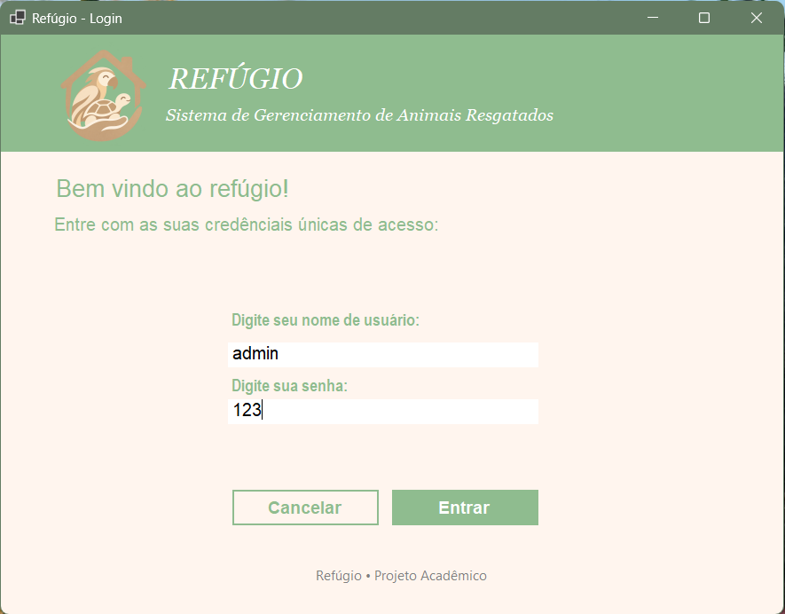
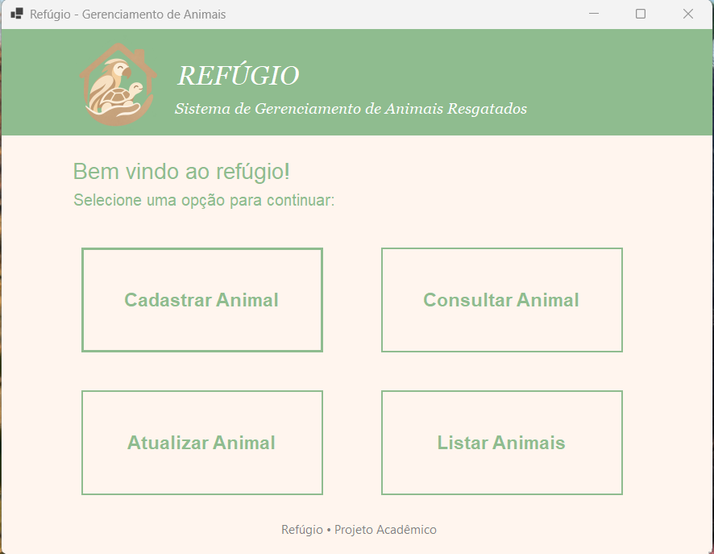
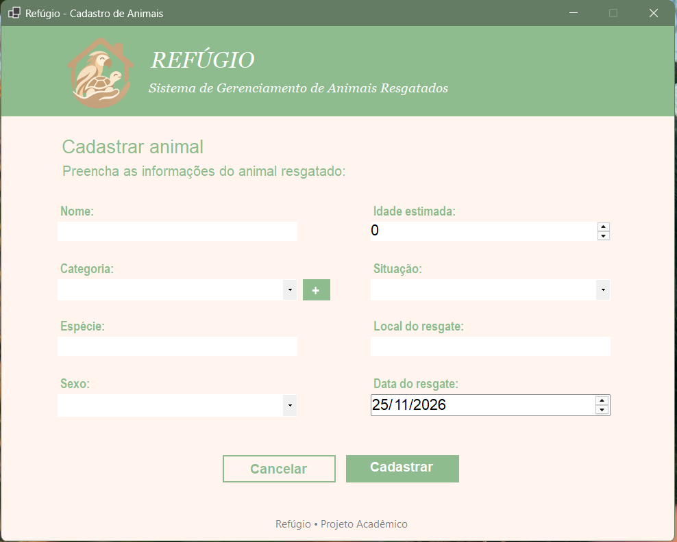
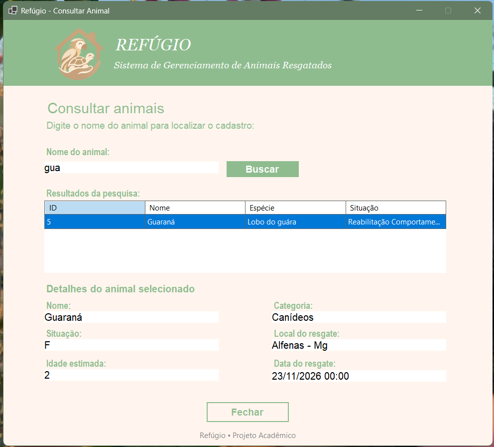
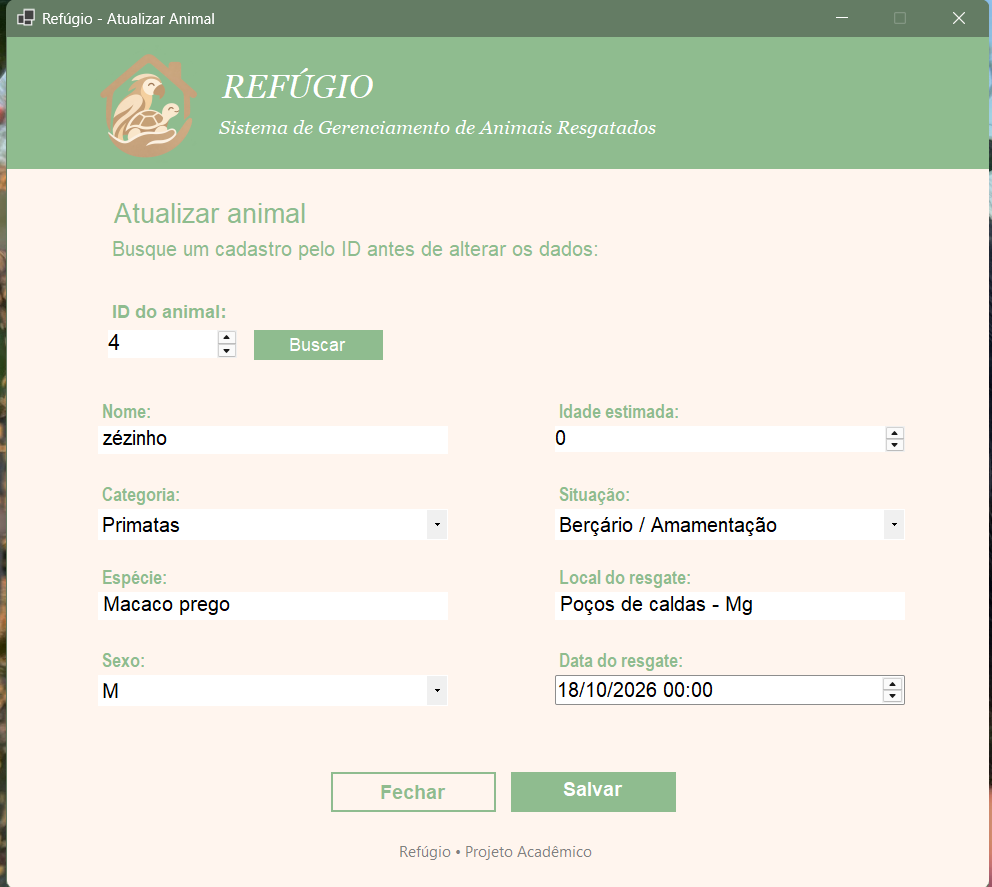
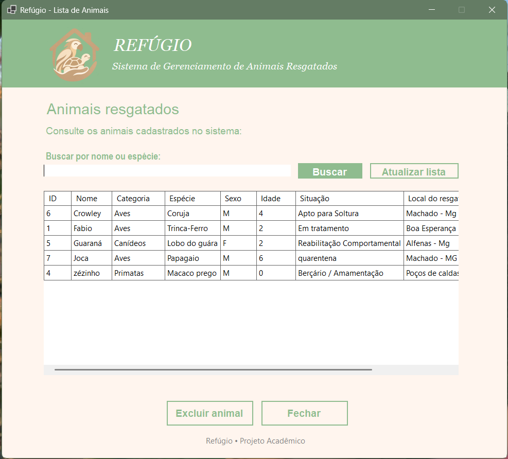

# 🌿 Refúgio — Sistema de Gerenciamento de Animais Resgatados

O **Refúgio** é uma aplicação desktop desenvolvida em **C# com Windows Forms** e integrada a um banco de dados **MySQL**. O projeto foi criado para auxiliar no **cadastro e gerenciamento de animais exóticos resgatados**, reunindo suas informações em um sistema simples e organizado.

## 🎯 Objetivos

O objetivo do Refúgio é facilitar o registro, a consulta e a manutenção de informações sobre animais resgatados, permitindo acompanhar dados como nome, categoria, espécie, sexo, idade estimada, situação, local e data do resgate.

## 🛠️ Tecnologias e ferramentas

- **C#** — lógica da aplicação;
- **Windows Forms** — interface gráfica desktop;
- **MySQL** — armazenamento dos dados;
- **SQL / Stored Procedures** — operações no banco de dados;
- **Visual Studio** — desenvolvimento e execução;
- **MySQL Workbench** — criação e administração do banco de dados.

## ✅ Funcionalidades

- **Login:** acesso ao sistema mediante usuário e senha;
- **Cadastrar animais:** inclusão de um novo animal resgatado;
- **Consultar animais:** pesquisa pelo nome, com exibição de resultados e detalhes;
- **Atualizar animais:** seleção de um registro e alteração de suas informações;
- **Listar animais:** visualização dos registros cadastrados;
- **Excluir animais:** remoção de registros.

## 💻 Requisitos para execução

Antes de executar o projeto, tenha instalado:

1. **Windows** com suporte à versão do .NET utilizada no projeto;
2. **Visual Studio** com a carga de trabalho de desenvolvimento para desktop com .NET;
3. **MySQL Server**;
4. **MySQL Workbench** ou outro cliente MySQL para importar o banco.

> **Observação:** confira no arquivo `.csproj` qual é a versão exata do .NET exigida e garanta que as dependências NuGet do projeto estejam restauradas.

## 🚀 Instalação e execução

### 1. Baixar o projeto

Na página do repositório, clique em **Code → Download ZIP** e extraia os arquivos. Outra opção é clonar o repositório:

```bash
git clone URL_DO_SEU_REPOSITORIO
```

### 2. Preparar o banco de dados

1. Inicie o serviço do MySQL.
2. Abra o MySQL Workbench e conecte-se ao servidor.
3. Importe ou execute os scripts SQL fornecidos no repositório, incluindo a criação do banco `banco_refugio`, tabelas e Stored Procedures.
4. Confira a existência das tabelas `animais_resgatados`, `categorias_animais` e `usuarios`.
5. Crie um usuário de acesso à aplicação seguindo o procedimento de inicialização de usuários do projeto.

### 3. Configurar a conexão

No Visual Studio, abra `ConectaBanco.cs` e ajuste a string de conexão para os dados do MySQL instalado em seu computador:

```csharp
server=localhost;port=3306;database=banco_refugio;user=SEU_USUARIO;password=SUA_SENHA;
```

O trecho acima é apenas um **modelo de configuração**. Não substitua a estrutura de conexão do projeto por essa linha isoladamente. 

### 4. Executar a aplicação

1. Abra a solução (`.sln`) ou o projeto (`.csproj`) no Visual Studio.
2. Aguarde a restauração dos pacotes NuGet, se necessária.
3. Compile o projeto usando **Compilar → Recompilar Solução**.
4. Pressione **F5** ou clique em **Iniciar**.
5. Faça login com uma conta cadastrada no banco de dados.

## 📷 Telas do sistema

> Salve as capturas reais do aplicativo na pasta `imagens/` do repositório, com os nomes indicados abaixo. Substitua ou remova as seções que não corresponderem à versão final.

### Tela de login



### Tela principal



### Cadastro de animais



### Consulta de animais



### Atualização de animais



### Listagem de animais



## 📚 Sobre o projeto

O Refúgio foi desenvolvido como **projeto acadêmico**, com foco na aplicação dos conhecimentos de programação em C#, construção de interfaces com Windows Forms e integração com um banco de dados relacional MySQL.

## 👩‍💻 Autoria

Desenvolvido como projeto acadêmico. **[Kauany O. Lima]**.
